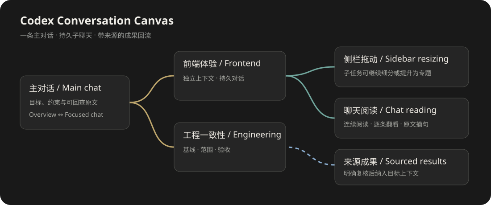

# Codex Conversation Canvas · 长对话画布

[中文](#中文) · [English](#english)

## 中文

**做一个项目时，我经常在同一条 AI 对话里讨论目标、调整界面、排查问题，又在某个细节上聊了很久。我开始做这个插件，希望这些讨论能长成一棵看得清、能继续聊、也能回到原文的对话树。**

**当前版本：0.6.33，Windows / Codex Desktop 实验预览版。** 画布在 Codex 内打开，使用现有聊天作为主干，让不同任务拥有各自的持久子聊天。

[下载安装包](https://github.com/RDold8/codex-conversation-canvas/releases/tag/v0.6.33) · [安装说明](docs/installation.md) · [版本与验证边界](docs/release-0.6.33.md) · [设计与实现](docs/architecture.md)

*上图是功能关系示意，不是 Codex 界面截图。*

### 我为什么做这个项目

长对话的问题不只是字数多。主目标、临时修正、需要复核的决定和已经完成的工作，会逐渐挤在同一条时间线上。另开聊天又容易丢掉来龙去脉；把所有分支反复塞回主对话，也会让上下文越来越重。

我希望保留一条明确的主对话，把界面修正、工程排查、资料整理等讨论分出去。某个小问题聊得越来越深时，可以继续细分，或者提高它的重要性。回到画布，我能看到整个项目；进入某张卡片，我又能像普通聊天一样继续工作。

### 它能帮你做什么

- **从已有聊天开始。** 按对话名称搜索并选择主对话或已有分支，不需要手填聊天编号。原文保存到本地，较早内容可以分页加载。
- **把讨论放进同一张画布。** 每张节点都是一个独立滚动的聊天框，支持四向展开、拖动、自由调整尺寸和多级分支样式。
- **在总览与阅读之间切换。** 小档显示一句原文摘句，中档逐条翻看，大档连续浏览已加载的上下文；双击节点进入聚焦聊天。
- **从某条旧消息继续分支。** 在历史消息处创建新聊天，记录分叉位置与来源。子 Bot 对应可继续打开的持久聊天，任务说明和执行范围分别保存。
- **让深入讨论逐步成长。** 子任务可以继续细分，重要的讨论可以提升为专题；树的深度、任务重要性和授权程度分别处理。
- **保留人工介入。** 可以设置复核与放权等级、编辑尚未发送的任务、批准一次或暂停子树。自动派发受当前授权、计划和限额约束。
- **有依据地共享成果。** 主干要求带来源与版本，分支成果经明确纳入才进入目标上下文；检查点记录已完成内容和下一行动。
- **检查工程是否一致。** 代码任务可绑定 Git 工程、基线、允许修改的路径和验收条件，检查范围重叠与代码变化，保存执行报告及完整日志。
- **导出与恢复任务。** 原文、主干版本、布局、上下文和检查点可以归档；恢复时核对来源与哈希，不自动重放未确认的请求。

例如，我把“完成一个 Codex 插件”设为主任务，再分出“前端阅读体验”和“工程一致性”两个持久聊天。在前端分支中，又把“侧栏拖动”作为更细的子任务。需要浏览上下文时进入对应聊天；需要看进度时返回画布；某个结论要影响主任务时，再明确选择它的来源和纳入范围。

### 我是怎么做的

我使用 **TypeScript + React + React Flow + MCP Apps** 实现插件。Codex 加载画布界面，Node.js 启动本地 MCP 服务，SQLite 保存任务、原文来源和恢复记录。运行时不需要 Python，也不需要安装另一个桌面应用。

我把主干版本、分支原文和共享成果分开保存。共享记忆不是把所有子聊天拼成长提示词，而是按来源选择本轮需要的内容，并控制上下文预算。代码任务额外核对工程范围，减少两个分支同时改动相同文件的风险。

插件可以整理本地上下文摘要，并对连续摘要设置限制；它不能控制 Codex 自身的自动压缩，也不能恢复宿主已经无法提供的历史。工程检查和授权规则能帮助发现冲突，仍需要针对实际任务复核。

### 如何开始

1. 安装 Node.js 24 或更高版本，确认本机 Codex CLI 可用。
2. 下载 Release 中的 ZIP，完整解压到一个固定目录。
3. 先运行 `powershell -NoProfile -File .\Install.ps1 -CheckOnly`，再运行 `powershell -NoProfile -File .\Install.ps1`。
4. 正常重新打开 Codex，从“插件”打开“长任务”；如果“探索”中出现入口，可以固定到侧边栏。
5. 建立画布，按名称选择主对话，再按需要绑定或分出子聊天。

完整步骤、更新方式和数据位置见[安装说明](docs/installation.md)。侧栏入口受 Codex 版本影响，安装成功与界面实际加载需要分别确认。

### 当前做到哪里，还有哪些不足

本机已实际使用过侧栏入口、按名称选聊天、独立滚动、完整历史阅读、历史消息分叉、续聊与取消、导出及部分工程检查。规则、协议和界面也有隔离测试。

**0.6.33 新增的分级复核、自动派发和工程范围借用仍需新版原生界面与真实长任务的完整验收。** 当前是预览版，不保证跨版本的 Codex 兼容性，也没有宣称超长任务、多分支并发和所有模型/工具组合均已通过测试。

小档目前是原文摘句，不是调用模型生成的摘要。主干创建表单的多段约束来源粒度仍需改进。后续会继续完善画布可读性、派发复核和跨分支工程协作。

源码、安装包不包含个人聊天数据库、历史导出或真实对话截图。使用时读取的记录保存在自己的 Codex 用户目录中；向模型继续发送任务时，所选上下文会通过 Codex 的正常聊天流程提交。

**初版，有许多不足之处，请见谅。**

## English

**When I work on a project with AI, goals, UI changes, investigations, and lengthy discussions about small details often end up in one chat. I started this plugin to turn those discussions into a conversation tree that I can navigate, continue, and trace back to its original messages.**

**Current release: 0.6.33, an experimental preview for Windows and Codex Desktop.** The canvas opens inside Codex and organizes an existing main chat together with persistent child chats.

[Download](https://github.com/RDold8/codex-conversation-canvas/releases/tag/v0.6.33) · [Installation](docs/installation.md) · [Release scope](docs/release-0.6.33.md) · [Architecture](docs/architecture.md)

### Why I am building it

The difficulty with long chats is not only their length. Project goals, small fixes, decisions awaiting review, and completed work gradually share the same timeline. Starting another chat can lose the background, while repeatedly copying every branch into the main chat makes its context heavier.

I want one clear main conversation, with UI work, investigations, and research in their own persistent chats. A small issue can grow into a deeper branch or become an important topic. The canvas gives me an overview; opening a card brings me back to the conversation.

### What it can help you do

- Find existing chats by name and select the main conversation without entering chat IDs.
- Arrange independently scrolling chat cards, extend the tree in four directions, and resize nodes and panels.
- Switch between an original-text excerpt, one-message reading, and continuous reading; double-click a node to focus its chat.
- Fork a persistent child chat from a particular historical message, retaining its source and task scope.
- Split work further or promote a discussion to a topic; depth, importance, and permission level are separate.
- Review pending dispatches, edit unsent tasks, approve once, or pause a subtree. Automatic dispatch is constrained by explicit policies, plans, and limits.
- Select sourced results for a target context, keep versioned main requirements, and save checkpoints and next actions.
- Bind code tasks to a Git baseline, allowed paths, and acceptance conditions; record checks and complete logs.
- Export and restore tasks with source and hash validation, without automatically replaying uncertain requests.

For example, I can keep “build a Codex plugin” as the main task, create persistent chats for frontend reading and engineering consistency, and split sidebar dragging into a smaller frontend task. I open a chat to read its context, return to the canvas to see the project, and explicitly choose which results should influence another task.

### How it works

The plugin uses **TypeScript, React, React Flow, and MCP Apps**. Codex hosts its interface, Node.js runs the local MCP service, and SQLite stores tasks, original-message sources, and recovery records. It does not require Python or a separate desktop application at runtime.

Main requirements, branch messages, and shared results are stored separately. Shared memory means selecting sourced material within a context budget, rather than concatenating every child chat. Code tasks also check their assigned engineering scope.

Local context summaries have limits on repeated compression. The plugin cannot control Codex's own automatic compaction or recover history the host no longer exposes. Engineering and permission checks support review; they do not guarantee conflict-free work.

### Getting started and current limits

Install Node.js 24+ and a working Codex CLI, download and fully extract the release ZIP to a permanent directory, run `Install.ps1 -CheckOnly`, then run `Install.ps1`. Reopen Codex normally and open “长任务” from Plugins; pin its entry from Explore if your Codex version exposes it. See the installation guide for commands and update details.

The local installation has been used for sidebar navigation, name-based chat selection, scrolling, full-history reading, historical forks, continuation/cancellation, exports, and selected engineering checks. Isolated rule, protocol, and UI tests also exist.

**The new 0.6.33 review policies, automatic dispatch, and temporary engineering-scope sharing still need complete native-UI and real long-task acceptance.** Cross-version compatibility, very long workloads, concurrent branches, and all model/tool combinations are not fully validated. Small cards use original-text excerpts, and source attribution for multi-part main requirements needs improvement.

Published source and packages exclude personal chat databases, exports, and real-chat screenshots. Your records are stored under your own Codex user directory; continuing a task sends the selected context through Codex's normal chat flow.

**This is an initial version with many shortcomings. Thank you for your understanding.**
